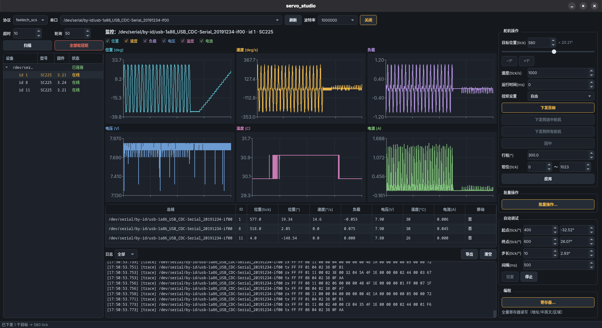

# servo_studio

飞特 SCS 系列（SC215/SC225）、UBTECH（优必选拆机关节舵机，非官方协议）与 UBTECH-LQL（liqiulong123 为 UBTECH 舵机编写的飞特协议兼容固件）总线舵机的 Linux 桌面上位机：一次连接多条串口总线、每条总线多个舵机，实时监控、运动控制、全参数读写与备份。

暗色扁平界面；UI 与采集后端解耦（Qt 界面只面向 `servo_core` 中立类型与`SessionBridge` 信号），通过 `servo_core` 中间层支持多厂商舵机后端（飞特 SCS / UBTECH / UBTECH-LQL，同一界面按协议能力切换操作面板）。



## 功能

- **连接管理**：串口枚举（by-id 优先）、波特率、应答超时，多总线并存
- **扫描识别**：一键扫描 0..253，显示 id / 型号 / 固件版本
- **实时监控**：6 通道滚动曲线（位置/速度/负载/电压/温度/电流，独立量程，30 s 时间窗；滚轮水平缩放、按住右键滚动水平位移、双击恢复默认窗口），多舵机状态表；轮询 10–100 Hz 可调
- **运动控制**：目标位置（tick 与度双显 + 滑杆）、速度、运行时间、±1° 点动、扭矩开关；单机下发或多机 SYNC WRITE 同步
- **参数管理**：按参数描述表渲染全部 26 项参数（ID、波特率、P/D、死区、限位、温压保护、扭矩限制、卸载/报警条件、过载保护等），EEPROM 写入自动走
  关扭矩 → 解锁 → 写入 → 回锁 安全流程；ID / 波特率修改走确认 → 写入 → 重扫/重连 专属流程
- **批量操作**：状态表多选统一同步下发；批量编排弹窗（逐台设目标/速度/时间，同步下发或异步预存 + 触发，预存有应答可确认）；参数一键写入总线全部舵机
- **参数备份**：整表备份为 JSON / 从备份恢复（恢复自动跳过 ID 与波特率）
- **日志**：事件日志 + 帧级 hex 收发跟踪，级别过滤、导出；除 trace 外各级最近 20 条保底缓存（trace 帧优先淘汰），切换级别仍可见历史日志
- **安全**：全局"全部松扭矩"急停、危险写入二次确认、命令钳位
- **UBTECH 协议（非官方文档）**：按协议能力针对性出组件——转动（角度 0–240° / 运动时间 / 锁定时间）、强制中止（失电）、角度回读（⚠回读后失电，仅手动单次、禁止轮询）、角度偏移校准（⅓°，掉电清零）、修改 ID、固件版本；无连续遥测，监控列按遥测能力全通道显示 "--"（操作面板为协议专属）
- **UBTECH-LQL（飞特协议兼容固件）**：支持 liqiulong123 为 UBTECH 拆机舵机重新编写的飞特 SCS 协议兼容固件
  （原项目：[gitee.com/liqiulong123/ubtech_servo_firmware](https://gitee.com/liqiulong123/ubtech_servo_firmware.git)，含 SAMD10 / Mega8 两种硬件）——
  帧/指令/控制表骨架与飞特一致，按 12 位几何（0–4095 counts）换算与播种钳位；SAMD10 指令齐全（含预存下发），
  Mega8 速度/负载按补码解码、无传感器通道显示 "--"；扭矩两态（无阻尼档）；应答错误位（欠压/过压/过热/堵转）
  宽容处理，经 `last_error` 参数与帧跟踪可见

## 构建

本工程是**独立 CMake 项目**，可单独构建，无需 ROS 环境。

依赖：CMake ≥ 3.22、Qt 6（Widgets、Charts）、任意支持 C++20 的 GCC（推荐 13 及以上；测试另需 GTest，可用 `-DBUILD_TESTING=OFF` 关闭）。

```bash
# 开发构建（含测试）
cmake -S . -B build
cmake --build build -j

# Release 构建（发布用）
cmake -S . -B build-release -DCMAKE_BUILD_TYPE=Release -DBUILD_TESTING=OFF
cmake --build build-release -j
```

- 编译器自动选择：优先 `g++-13`（约定工具链），未安装时依次回退`g++-14` / `g++-15` / `g++-16` / `g++`；也可用 `-DCMAKE_CXX_COMPILER`或 `CXX=` 显式指定，**不强制要求安装 g++-13**。
- 驱动源码路径由 `-DFEETECH_DRIVER_DIR=<path>` 指定；未配置时默认从上一级目录寻找 `feetech_scs_ros2_control`。
- 驱动中无 ROS 依赖的核心源文件会被编译为本工程的 `feetech_scs_core`静态库，整个上位机不依赖 ROS。

## 测试

```bash
ctest --test-dir build --output-on-failure
```

覆盖飞特后端（FakeScsBus 总线级）、UBTECH 后端（FakeUbtechBus 帧级：编码/钳位/短回应/坏校验和/静默超时）、UBTECH-LQL 后端（FakeLiqiulongBus：双变体/锁门/宽容错误位/补码解码，19 例）、BusSession 并发行为与参数备份格式。

## 运行

```bash
# 开发构建
./build/servo_studio

# Release 构建
./build-release/servo_studio
```

典型流程：顶部选择串口 → 打开 → 扫描 → 在设备树或状态表中选中舵机（曲线与参数自动加载）→ 命令区下发目标 / 参数区读写。

## 目录结构

```
src/servo_core/       中间层：IServoDriver、中立类型、DriverRegistry、BusSession
src/backends/feetech_scs/  飞特 SCS 后端（适配 feetech_scs_ros2_control）
src/backends/ubtech/  UBTECH 后端（非官方协议，帧层自研，无外部依赖）
src/backends/ubtech_liqiulong123/  UBTECH-LQL 后端（MicroDuck 固件，作者 liqiulong123）
src/app/              Qt6 GUI：主窗口、各面板、主题、参数备份
tools/servo_smoke.cpp 无 GUI 冒烟命令行工具
test/                 gtest 单元/集成测试
```
